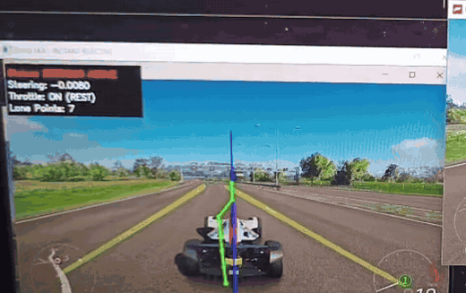
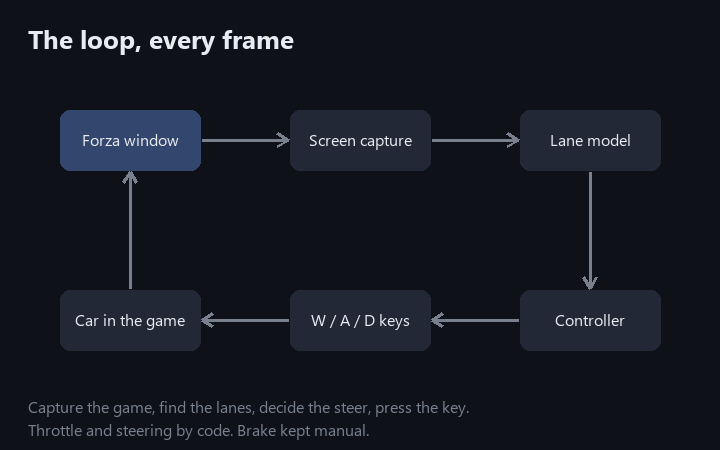
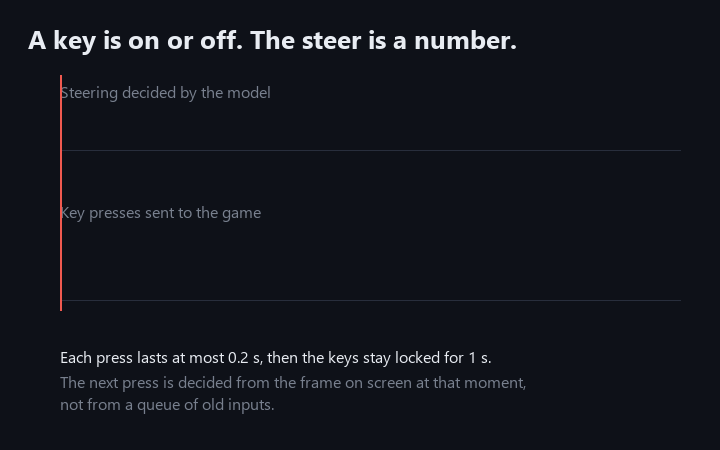
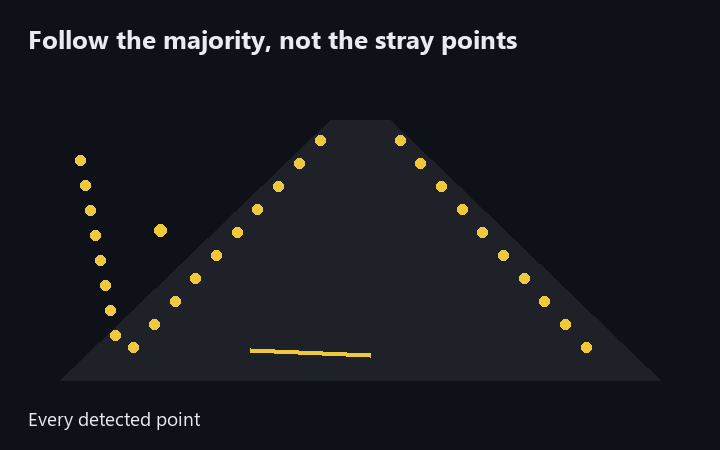

# GamePilot

Lane keeping in Forza Horizon 4, driven by computer vision. Built in August 2025 as a test bed for lane keeping, later my fifth semester minor project: an AI pilot for racing games using computer vision and control algorithms.

## What it does

`forza_lka.py` captures the Forza window live, runs each frame through YOLOPv2 lane detection, decides a steering value, and presses W, A and D from code. Braking stays manual so the driver can take over.

Two things made it hold the lane:

- **Majority of points.** Steering follows what most of the detected lane points agree on. Lanes far from the centre of the screen and flat horizontal lines are ignored.
- **Short key bursts with a lockout.** A key is on or off but the controller outputs a number. Each steering press is a short burst, then the keys lock for one second, and every press is decided from the current frame instead of a queue of old inputs.

`forza_tlsd.py` runs traffic light and speed sign detection on the same live capture, with Tesseract OCR for the speed values. It only displays detections and does not control the car.

The full run from 18 August 2025 is in [media/forza-run-2025-08-18.mp4](media/forza-run-2025-08-18.mp4).

## Running it

Windows only, since keys are sent through the Win32 API.

1. Run Forza Horizon 4 in borderless windowed mode.
2. `pip install -r requirements.txt`
3. Put the YOLOPv2 weights (`yolopv2.pt`) from the [YOLOPv2 release](https://github.com/CAIC-AD/YOLOPv2) next to the script.
4. `python forza_lka.py`

`forza_tlsd.py` needs a traffic light and sign model saved as `best_tdfs.pt` and Tesseract installed. That model is not included.

No model weights are stored in this repository.
